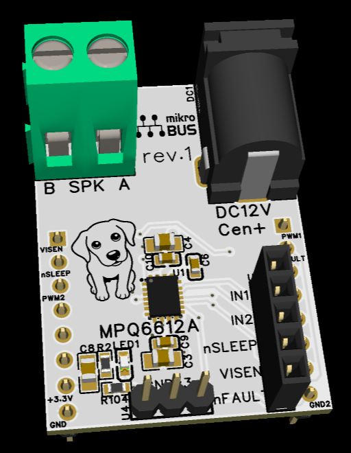
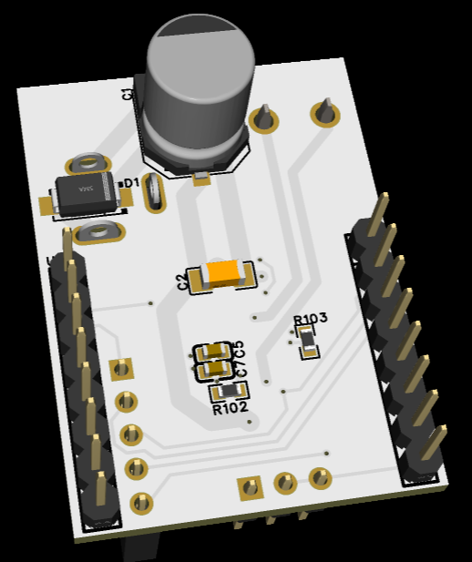

# MPQ6612A mikroBUS PWM Audio Board (EasyEDA Pro)

<p align="center">
  
  
</p>
<p align="center"><i>rev.01 - built and verified on hardware. Front and back 3D views.</i></p>

A mono, filterless BTL PWM audio power-stage board in the mikroBUS&trade; form
factor, built around the Monolithic Power Systems **MPQ6612AGLE-AEC1-Z**. The
board accepts external PWM control from a 3.3 V host, takes the bridge supply
from a centre-positive barrel jack, and drives a speaker between its `OUT1` and
`OUT2` terminals.

This repository holds the editable EasyEDA Pro project and exported reference
files: a schematic PDF and front/back PCB images.

日本語の説明は[このファイルの後半](#日本語)にあります。

## Hardware status

- rev.01 has been assembled and used with the Sonora AK512 `Classic 1` PWM
  audio configuration.
- The silkscreen says `DC12V`, matching the original intended bridge supply.
  A **5 V bridge supply has also been confirmed to produce useful sound with a
  small, tweeter-like speaker**. This is a limited functional observation, not
  a guarantee of output power, audio performance, or operation with every
  speaker and signal condition.
- The design files and firmware integration do not by themselves qualify POP,
  output power, current, temperature, efficiency, EMI, or long-term endurance.

## Project files

| Directory | EasyEDA Pro project | Status | Included reference outputs |
| --- | --- | --- | --- |
| `MPQ6612A_mikroBUS_01` | `MPQ6612A-non-D_MikroBUS_01.eprj2` | Built, functionally verified | Schematic PDF and front/back PCB PNG files |

The `.eprj2` file is the editable EasyEDA Pro source. The PDF and PNG files are
exports for reviewing the schematic and PCB without opening EasyEDA.

## Connections and safety notes

### Power

- The mikroBUS&trade; `3.3V` pin powers the board's logic interface and fault
  pull-up.
- The barrel jack supplies the MPQ6612A bridge `VIN`. It is centre-positive;
  check polarity before applying power.
- The `DC12V` silkscreen is not a statement that 12 V is the only usable
  voltage. The 5 V observation above applies only to the tested small-speaker
  setup. Select a supply and speaker within the IC, board, and load limits.

### Speaker output

Connect the speaker **between** `OUT1 / SPK A` and `OUT2 / SPK B`. This is a BTL
output: **do not connect either speaker lead to GND**.

### mikroBUS&trade; pin map

| mikroBUS pin | Board signal | Direction at the board | Purpose |
| --- | --- | --- | --- |
| `AN` | `VISEN` | Output | Current-sense voltage from the MPQ6612A |
| `RST` | `nSLEEP` | Input | Active-low bridge sleep control |
| `CS` | `IN2` | Input | Second external PWM / bridge-control input |
| `PWM` | `IN1` | Input | First external PWM / bridge-control input |
| `INT` | `nFAULT` | Output | Active-low fault; pulled up to 3.3 V through 10 kOhm on this board |
| `3.3V` | `+3.3V` | Power | Logic supply and `nFAULT` pull-up supply |
| `GND` | `GND` | Power | Logic/power ground reference |

The remaining standard signal pins are not used by this design. Debug headers
expose the control signals and ground references for bench work.

`nFAULT` High is **not** a bridge-supply power-good indication. The board-side
pull-up can read High when the board is attached but the external bridge supply
is absent. Host firmware must not infer `VIN` presence from `nFAULT` alone.

## Sonora firmware support

The public
[Sonora dsPIC33AK audio DSP firmware](https://github.com/sulaolab/dspic33ak-audio-dsp-sonora)
contains the corresponding `Classic 1` PCM-to-PWM path. The board-level signal
contract is:

```text
IN1=PWM, IN2=CS, nSLEEP=RST, nFAULT=INT, VISEN=AN
```

On the AK512 Curiosity Platform, Sonora supports an upper-XPRO1 route through an
adapter and an optional mikroBUS-B route. A two-board configuration sends the
processed Left channel to mikroBUS-B and Right to XPRO1; either populated route
can also be used independently. The evaluated small-speaker setup used a
192 kHz PWM carrier; 48 kHz was audible as carrier hum in that setup.

Firmware build success and console status are not substitutes for electrical
measurements at the speaker, `IN1`/`IN2`, or `nSLEEP` pins.

## Opening the project

Open or import `MPQ6612A-non-D_MikroBUS_01.eprj2` with EasyEDA Pro. Keep the
project file and its PDF/PNG exports together when sharing this revision.

**Import warning:** this project descends from the WM8904 mikroBUS project and
retains its internal project name (`WM8904_MikroBUS_01`) and project UUID. That
UUID is also present in the WM8904 rev.04/rev.05 project files in
[EasyEDA-WM8904-mikroBUS](https://github.com/sulaolab/EasyEDA-WM8904-mikroBUS).
Importing both designs into one EasyEDA account or workspace may collide or
overwrite. Use a separate workspace/account, or rename the first imported
project before importing the other one.

## mikroBUS&trade; standard and trademarks

mikroBUS&trade; was created by MikroElektronika and published as an open
standard. The logo appears on the board as required by the standard. This is a
third-party board, not a MikroElektronika product or a click board&trade;, and it
is not endorsed by MikroElektronika.

Verify mechanical clearance before use in a multi-socket carrier or enclosure;
connector compatibility alone does not establish enclosure clearance.

## License

Original material contributed to this repository is dedicated to the public
domain under [CC0 1.0 Universal](https://creativecommons.org/publicdomain/zero/1.0/).
The full legal text is in [LICENSE](LICENSE).

This dedication applies only to original material for which the contributor
holds the relevant rights. It does not apply to third-party component
libraries, datasheets, reference designs, trademarks, patents, or other
material owned by their respective rights holders. The dog line-art on the
silkscreen was generated from a photograph of the author's own dog.

`mikroBUS` and `click board` are trademarks of MikroElektronika. `MPQ6612A` and
related marks belong to Monolithic Power Systems. They are used here only to
identify the socket standard and the component.

This is a hobby/experimental reference design supplied without warranty of any
kind, including fitness for a particular purpose. Fabrication and use are at
your own risk.

---

<a id="日本語"></a>

# 日本語

Monolithic Power Systems **MPQ6612AGLE-AEC1-Z** を使用した、mikroBUS&trade;
形状のモノラル・フィルタレスBTL PWMオーディオ出力基板です。3.3 Vホストから
外部PWM信号を受け、センタープラスのDCジャックからブリッジ電源を供給し、
`OUT1` と `OUT2` の間に接続したスピーカを駆動します。

このリポジトリには、編集可能なEasyEDA Proプロジェクトと、参照用に書き出した
回路図PDF・基板表裏PNGを収録しています。

## 実機確認状況

- rev.01は製作済みで、Sonora AK512の`Classic 1` PWMオーディオ構成で機能確認
  しています。
- シルクは当初想定したブリッジ電源に合わせて`DC12V`と表記しています。
  一方、**ツイータのような小型スピーカでは、ブリッジ電源5 Vでも実用的な音量で
  動作することを確認済み**です。これは確認した小型スピーカ構成での限定的な
  動作結果であり、あらゆるスピーカ・信号条件での出力、音質、性能を保証する
  ものではありません。
- POP、最大出力、電流、温度、効率、EMI、長時間耐久性は、この公開物だけでは
  評価済みとはしません。

## プロジェクトファイル

| ディレクトリ | EasyEDA Proプロジェクト | 状態 | 参照出力 |
| --- | --- | --- | --- |
| `MPQ6612A_mikroBUS_01` | `MPQ6612A-non-D_MikroBUS_01.eprj2` | 製作・機能確認済み | 回路図PDF、基板表裏PNG |

`.eprj2`が編集可能なEasyEDA Proソースです。PDFとPNGは、EasyEDAを開かずに
回路・基板を確認するための書き出し済みファイルです。

## 接続と注意事項

### 電源

- mikroBUS&trade;の`3.3V`は、ロジックインターフェースと`nFAULT`プルアップの
  電源です。
- DCジャックはMPQ6612Aのブリッジ`VIN`へ給電します。センタープラスです。
  給電前に極性を確認してください。
- `DC12V`のシルクは「12 V以外では動かない」という意味ではありません。ただし、
  上記の5 V確認は小型スピーカでの結果です。IC・基板・負荷の定格内で電源と
  スピーカを選定してください。

### スピーカ出力

スピーカは`OUT1 / SPK A`と`OUT2 / SPK B`の**間**に接続します。BTL出力のため、
**どちらのスピーカ端子もGNDへ接続しないでください**。

### mikroBUS&trade;ピン割り当て

| mikroBUSピン | 基板信号 | 基板から見た方向 | 用途 |
| --- | --- | --- | --- |
| `AN` | `VISEN` | 出力 | MPQ6612Aの電流検出電圧 |
| `RST` | `nSLEEP` | 入力 | アクティブLowのスリープ制御 |
| `CS` | `IN2` | 入力 | 第2外部PWM／ブリッジ制御入力 |
| `PWM` | `IN1` | 入力 | 第1外部PWM／ブリッジ制御入力 |
| `INT` | `nFAULT` | 出力 | アクティブLowの故障信号。本基板上で10 kOhmにより3.3 Vへプルアップ |
| `3.3V` | `+3.3V` | 電源 | ロジックおよび`nFAULT`プルアップ電源 |
| `GND` | `GND` | 電源 | ロジック／電力系の基準GND |

その他の標準信号ピンは使用していません。デバッグ用ヘッダには制御信号とGND系を
引き出しています。

`nFAULT`がHighでも、ブリッジ電源が存在することの証明にはなりません。外部ブリッジ
電源がない状態でも、基板側のプルアップによりHighを読む場合があります。ホスト側は
`nFAULT`だけから`VIN`の有無を判断しないでください。

## Sonoraファームウェア対応

公開版の
[Sonora dsPIC33AK audio DSPファームウェア](https://github.com/sulaolab/dspic33ak-audio-dsp-sonora)
には、対応する`Classic 1` PCM-to-PWM経路が入っています。基板との信号契約は
次のとおりです。

```text
IN1=PWM, IN2=CS, nSLEEP=RST, nFAULT=INT, VISEN=AN
```

AK512 Curiosity Platformでは、アダプタ経由の上段XPRO1経路と、オプションの
mikroBUS-B経路に対応します。2枚構成ではmikroBUS-Bへ処理済みLeft、XPRO1へ
処理済みRightを出力し、実装された片側だけでも動作できます。評価した小型
スピーカ構成では192 kHz PWMキャリアを使用しました。48 kHzキャリアではハムが
聞こえ、192 kHzでは聞こえませんでした。

ビルド成功やコンソール表示は、スピーカ端子、`IN1`/`IN2`、`nSLEEP`端子での
電気的実測を代替しません。

## プロジェクトを開く

`MPQ6612A-non-D_MikroBUS_01.eprj2`をEasyEDA Proで開くかインポートします。
共有するときは、同じリビジョンのプロジェクトとPDF/PNGをセットで扱ってください。

**インポート時の注意:** 本プロジェクトはWM8904 mikroBUSプロジェクトから派生し、
内部プロジェクト名`WM8904_MikroBUS_01`とproject UUIDを引き継いでいます。このUUIDは
[EasyEDA-WM8904-mikroBUS](https://github.com/sulaolab/EasyEDA-WM8904-mikroBUS)
のrev.04/rev.05にも含まれています。同じEasyEDAアカウント／ワークスペースへ両方を
インポートすると、衝突または上書きの恐れがあります。別ワークスペース／アカウントを
使うか、先にインポートした側のプロジェクト名を変更してから次を取り込んでください。

## mikroBUS&trade;標準と商標

mikroBUS&trade;はMikroElektronikaが作成し、オープン標準として公開しています。
標準の要件に従い、基板上にmikroBUS&trade;ロゴを表示しています。本基板は第三者設計で、
MikroElektronika製品またはclick board&trade;ではなく、同社の推奨・承認を受けたものでも
ありません。

複数ソケットが並ぶキャリアや筐体で使う場合は、コネクタ互換性だけで判断せず、機械的な
クリアランスを確認してください。

## ライセンス

本リポジトリへ寄稿された独自成果物は、
[CC0 1.0 Universal](https://creativecommons.org/publicdomain/zero/1.0/)により
パブリックドメインへ提供します。法的な全文は[LICENSE](LICENSE)にあります。

この放棄が及ぶのは、寄稿者が権利を保有する独自部分のみです。第三者の部品ライブラリ、
データシート、リファレンス設計、商標、特許その他の権利には適用されません。シルクの犬の
線画は、作者自身が飼っている犬の写真から生成したものです。

`mikroBUS`および`click board`はMikroElektronikaの商標です。`MPQ6612A`および関連する
標章はMonolithic Power Systemsに帰属します。ここではソケット規格と部品を識別する
目的でのみ使用しています。

本設計は趣味・実験目的の参考として、特定目的への適合性を含むいかなる保証もなく提供
されます。製造・使用は自己責任で行ってください。
